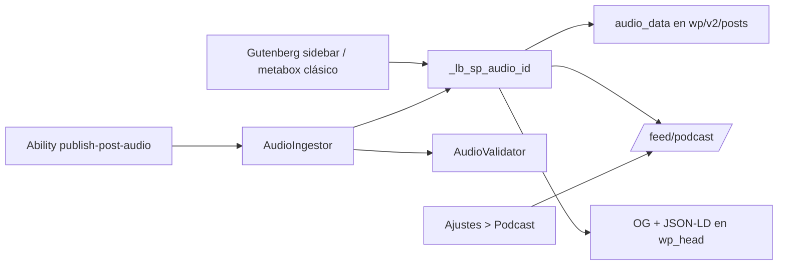

# Arquitectura de LB Simple Podcast

Plugin de WordPress (≥ 6.4, PHP ≥ 8.1) que asocia un MP3 a cada `post`, publica un feed RSS para podcatchers, agrega metadatos SEO y expone una ability MCP.

- Slug / text domain / archivo principal: `lb-simple-podcast`
- Namespace PHP: `LbSimplePodcast` (PSR-4 sobre `inc/`)
- Prefijo de opciones, hooks y filtros: `lb_sp_`

## Vista general

La única fuente de verdad del audio es el meta `_lb_sp_audio_id` (ID de un attachment `audio/mpeg`). Todo lo demás (URL, tamaño, duración) se deriva del attachment, por lo que no puede desincronizarse.

## Componentes

| Clase | Responsabilidad |
| --- | --- |
| `Plugin` | Bootstrap. `boot()` crea los servicios (`audio_meta`, `editor_assets`, `meta_box`, `settings_page`, `feed`, `seo_headers`, `mcp_ability`). `activate()` registra el feed y refresca las rewrite rules. |
| `Meta\AudioMeta` | `register_post_meta` de `_lb_sp_audio_id` (REST, `absint`, `auth_callback` → `edit_post`), bloqueo de escrituras inválidas, campo REST `audio_data`, y helpers `get_attachment_id()` / `get_audio_data()`. |
| `Media\AudioValidator` | Mime real (`wp_check_filetype_and_ext` + `finfo`), tamaño máximo y duración (`wp_read_audio_metadata`). Devuelve `WP_Error` con códigos `lb_sp_*`. |
| `Media\AudioIngestor` | Ingesta por URL (anti-SSRF, tope de tamaño, timeout) o base64 (tamaño estimado antes de decodificar, decodificación estricta). Reemplaza el audio anterior sin dejar huérfanos. |
| `Admin\EditorAssets` | Encola el panel de Gutenberg solo en el editor de `post`. |
| `Admin\MetaBox` | Respaldo para el editor clásico (nonce, capability, validación). |
| `Admin\SettingsPage` | Ajustes del canal (Ajustes > Podcast), opción `lb_sp_channel`. |
| `Feed\FeedRegistrar` | `add_feed( 'podcast' )`, cabeceras, invalidación de caché. |
| `Feed\PodcastFeedRenderer` | Query, datos del canal/episodios, ETag/Last-Modified/304 y caché del cuerpo. |
| `Feed\FeedVersion` | Marca temporal del último cambio relevante (base del ETag). |
| `Feed\Xml` | Escape y formato de XML (`&amp; &lt; &gt; &apos; &quot;`, CDATA, duración, RFC 2822). |
| `Integrations\SeoHeaders` | `og:audio` y JSON-LD `AudioObject` en `wp_head`, sin duplicar lo ya impreso. |
| `Integrations\McpAbility` | Ability `lb-simple-podcast/publish-post-audio` (Abilities API). |

## Decisiones de diseño

### Tamaño máximo
`AudioValidator::max_bytes()` = `min( wp_max_upload_size(), (memory_limit - uso actual) / 3 )`, filtrable con `lb_sp_max_audio_bytes`. El factor 3 reserva memoria para el base64 (≈1,33×) más su decodificación.

### Anti-SSRF (`audio_url`)
1. Solo `http`/`https`, sin credenciales en la URL.
2. `wp_http_validate_url()` y comprobación propia de IP (IPv4 e IPv6, rangos privados y reservados).
3. Descarga con `wp_safe_remote_get` (revalida las redirecciones), `stream`, `limit_response_size` y timeout (`lb_sp_download_timeout`, 30 s).
4. Hosts de confianza (p. ej. un servidor local) con el filtro `lb_sp_audio_url_allowlist`; con ellos se desactivan las redirecciones.

Se usa `wp_safe_remote_get` en lugar de `download_url()` porque este último no permite fijar un tope de tamaño.

### Reemplazo idempotente
Los attachments creados por el plugin llevan el meta `_lb_sp_ingested`. Al reemplazar el audio de un post solo se borra el anterior si lo creó el plugin y pertenece a ese post; un MP3 elegido a mano de la biblioteca nunca se borra.

### Feed y caché
- Contenido: posts `publish`, sin contraseña, con `_lb_sp_audio_id` numérico `> 0` (`meta_query` con `compare '>'`, `type NUMERIC`), máximo `lb_sp_feed_limit` (100).
- `FeedVersion` se actualiza al publicar/despublicar, guardar, borrar, cambiar el meta del audio, editar un attachment y guardar los ajustes. De ahí salen `Last-Modified` y el ETag; el cuerpo XML se cachea en el transient `lb_sp_feed_body` (12 h) y se invalida con la versión.
- Responde 304 con `If-None-Match` (ignora el prefijo `W/` y el sufijo `-gzip` que añade `mod_deflate`) o `If-Modified-Since`.
- `feed_content_type` y `exit_on_http_head` hacen que HEAD devuelva las mismas cabeceras que GET.
- WordPress agrega slashes a `$_SERVER`: se usa `wp_unslash()` antes de comparar cabeceras.

### SEO
`SeoHeaders` captura la salida de `wp_head` (prioridad 0 a 99) solo en entradas con audio, la reimprime sin cambios y agrega únicamente lo que falte (`og:audio` o `AudioObject`). Ni Yoast SEO ni Rank Math emiten `og:audio` por su cuenta, por lo que la inspección de la salida es independiente del plugin SEO instalado. Si hiciera falta integrarse en sus APIs: Yoast `wpseo_frontend_presenters` / `wpseo_schema_graph_pieces`; Rank Math `rank_math/opengraph/facebook`. Esa integración no se probó (los plugins no están instalados en el entorno).

Filtros: `lb_sp_seo_output_og`, `lb_sp_seo_output_jsonld`, `lb_sp_seo_jsonld`.

### Filtros y hooks públicos

| Filtro | Uso |
| --- | --- |
| `lb_sp_max_audio_bytes` | Tamaño máximo de audio. |
| `lb_sp_audio_url_allowlist` | Hosts exentos de la comprobación anti-SSRF. |
| `lb_sp_download_timeout` | Timeout de descarga (s). |
| `lb_sp_feed_limit`, `lb_sp_feed_cache_ttl`, `lb_sp_feed_cache_control` | Tamaño y caché del feed. |
| `lb_sp_feed_channel`, `lb_sp_feed_items` | Datos del canal y de los episodios antes de renderizar. |
| `lb_sp_episode_explicit`, `lb_sp_episode_type` | `itunes:explicit` e `itunes:episodeType` por episodio. |
| `lb_sp_seo_output_og`, `lb_sp_seo_output_jsonld`, `lb_sp_seo_jsonld` | Metadatos SEO. |

## Desinstalación
`uninstall.php` borra las opciones (`lb_sp_channel`, `lb_sp_feed_version`) y el transient del feed. No toca los attachments ni el meta de las entradas, para no perder contenido del usuario.

## Limitaciones conocidas
- Una sola categoría de Apple (sin subcategorías).
- Imagen del canal: JPG/PNG cuadrada de 1400 a 3000 px (validación por metadatos de WordPress).
- La compatibilidad HEAD/byte-range de los archivos MP3 depende del servidor web, no del plugin.
- La matriz de CI usa la última versión de WordPress; las versiones antiguas (6.4–6.8) no se probaron.
