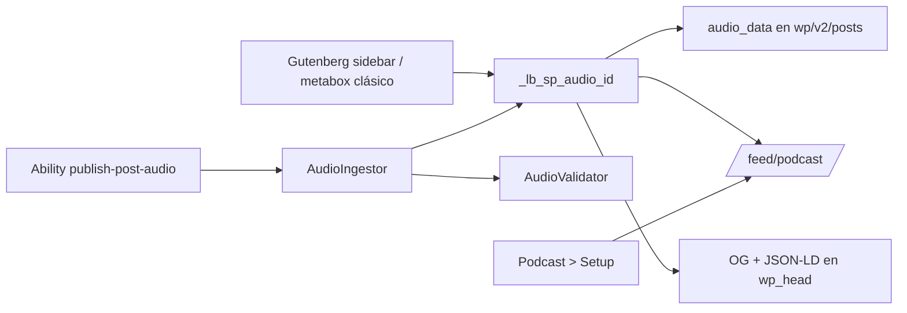

# Arquitectura de LB Simple Podcast

Plugin de WordPress (≥ 6.4, PHP ≥ 8.1) que asocia un MP3 a cada `post`, publica un feed RSS para podcatchers, agrega metadatos SEO y expone una ability MCP.

- Slug / text domain / archivo principal: `lb-simple-podcast`
- Namespace PHP: `LbSimplePodcast` (PSR-4 sobre `inc/`)
- Prefijo de opciones, hooks y filtros: `lb_sp_`

## Vista general



La fuente de verdad del audio es el meta `_lb_sp_audio_id` (ID de un attachment `audio/mpeg`). El tamaño y la duración se derivan del attachment; la URL pública del plugin pasa por la ruta de entrega y registro descrita abajo.

## Entrega y registro de solicitudes

La URL `/?lb_sp_audio=ID_ENTRADA&lb_sp_attachment=ID_ATTACHMENT` sirve el audio asociado actualmente. El reproductor, el feed, REST, SEO y MCP utilizan esa URL. Se admiten GET y HEAD, rangos simples y respuestas 200, 206 y 416; se ignoran rangos múltiples, inválidos o con `If-Range`, y las solicitudes condicionales se responden con el archivo completo. La respuesta prohíbe la caché, pero los intermediarios ajenos podrían ignorar esa instrucción. La entrega local transmite bloques desde PHP.

Las entradas publicadas sin contraseña son públicas. Para otros estados se comprueba `read_post` y, si corresponde, la contraseña. Una URL antigua deja de funcionar cuando cambia el attachment. No es DRM: cualquier cliente que recibe audio puede guardarlo.

Por defecto se sirve el archivo original local. Opcionalmente, un administrador puede definir `LB_SP_PRIVATE_AUDIO_DIR` en `wp-config.php` con un directorio ya existente y escribible, accesible a PHP y situado fuera de `ABSPATH`, del directorio de uploads y del `DOCUMENT_ROOT`. Se crean allí copias con nombre `lb-sp-{id-sitio}-{id-attachment}-{hash}.mp3` y permisos 0600. Para detectar cambios se calcula SHA-256 del original y de la copia en cada solicitud; esto aumenta la carga de E/S para archivos grandes. Verificar también que ninguna configuración del servidor, alias, CDN o montaje lo exponga: el plugin no puede detectar todas esas configuraciones. Las copias se conservan al reemplazar y desinstalar; un administrador puede identificarlas y eliminarlas manualmente después de comprobar que ya no las necesita.

El filtro `lb_sp_private_audio_dir` permite especificar el mismo directorio desde código; se aplican las mismas comprobaciones.

Si no puede crearse una copia, se sirve el original local y se muestra un aviso. Sin archivo local legible, se redirige a la URL del attachment si es válida y se muestra un aviso. **Los originales públicos, enlaces antiguos, redirecciones, cachés y copias externas pueden eludir la ruta y el registro**. Una solicitud registrada no equivale a una escucha o descarga completa; los reproductores suelen realizar varias solicitudes.

### Tabla SQL

`{prefix}lb_sp_audio_requests` es independiente para cada sitio. Se crea y actualiza mediante `dbDelta` en `init`, con la versión en la opción `lb_sp_log_schema_version`. La instalación invalida el cuerpo y la versión del feed. La tabla usa el charset/collation del sitio. Al desinstalar se elimina junto con las opciones de estado; no se eliminan attachments, metadatos de entradas ni copias.

| Columna | Tipo | Contenido |
| --- | --- | --- |
| `id` | `bigint unsigned`, clave primaria | Identificador autoincremental. |
| `requested_at` | `datetime` | Momento de la solicitud, UTC. |
| `post_id`, `attachment_id` | `bigint unsigned` | IDs recibidos para la entrada y el attachment; cero si faltan. |
| `user_id` | `bigint unsigned` | ID de usuario conectado, o cero. |
| `method` | `varchar(32)` | Método HTTP, limitado a 32 bytes. |
| `remote_addr` | `varchar(45)` | IP del interlocutor visto por PHP, limitada a 45 bytes; puede ser un proxy. |
| `request_url` | `longtext` | URL reconstruida con esquema, host y URI recibida, incluida la cadena de consulta. |
| `headers` | `longtext` | Objeto JSON con las cabeceras que el servidor proporciona a PHP; bytes UTF-8 inválidos se sustituyen. |
| `status` | `smallint unsigned` | Código HTTP previsto de la respuesta. |

Índices: `requested_at`, `(post_id, requested_at)` y `(attachment_id, requested_at)`. Se guarda una fila por solicitud que llega a la ruta, incluso HEAD, errores, rangos y redirecciones, sin deduplicación. Los datos no disponibles en PHP no se pueden recuperar; no se capturan huellas TLS JA3/JA4. Si falla la inserción se continúa la entrega y se muestra un aviso administrativo.

**Datos sensibles:** se guardan deliberadamente todas las cabeceras disponibles y la URL completa, incluidas posibles cookies, credenciales, tokens y datos personales, sin límite temporal ni limpieza automática. Restringir el acceso a la base, sus copias de seguridad y registros de errores; evaluar obligaciones legales y de privacidad antes de activar el plugin. El volumen de datos puede crecer rápidamente. Esta etapa no incluye consentimiento, pantalla de consulta, exportación ni borrado individual.

## Componentes

| Clase | Responsabilidad |
| --- | --- |
| `Plugin` | Bootstrap. `boot()` crea los servicios (`audio_meta`, `editor_assets`, `meta_box`, `settings_page`, `feed`, `player`, `stats_shortcode`, `seo_headers`, `mcp_ability`). `activate()` registra el feed y refresca las rewrite rules. |
| `Meta\AudioMeta` | `register_post_meta` de `_lb_sp_audio_id` (REST, `absint`, `auth_callback` → `edit_post`), bloqueo de escrituras inválidas, campo REST `audio_data`, y helpers `get_attachment_id()` / `get_audio_data()`. |
| `Media\AudioValidator` | Mime real (`wp_check_filetype_and_ext` + `finfo`), tamaño máximo y duración (`wp_read_audio_metadata`). Devuelve `WP_Error` con códigos `lb_sp_*`. |
| `Media\AudioIngestor` | Ingesta por URL (anti-SSRF, tope de tamaño, timeout) o base64 (tamaño estimado antes de decodificar, decodificación estricta). Reemplaza el audio anterior sin dejar huérfanos. |
| `Admin\EditorAssets` | Encola el panel de Gutenberg solo en el editor de `post`. |
| `Admin\MetaBox` | Respaldo para el editor clásico (nonce, capability, validación). |
| `Admin\Menu` | Menú Podcast con los submenús Dashboard, Setup y Logs. |
| `Admin\DashboardPage` / `Admin\LogsPage` | Estadísticas con caché de 1 h (KPIs de escuchas estimadas, solicitudes GET, oyentes únicos, gráficas SVG de tendencia diaria y clientes, filtro por período/episodio y top 10 excluyendo `HEAD` y bots) y tabla paginada (50 filas) de `lb_sp_audio_requests`. |
| `Tracking\RequestStats` | Consultas de lectura y agregación de la tabla de solicitudes (incluye clasificación de `User-Agent`, detección de bots, caché en transient de 1 h y `public_stats()` sin PII para el frontend). |
| `Frontend\PlayerInjector` | Inyección automática del reproductor HTML5 en `the_content` (`templates/player.php`). |
| `Frontend\StatsShortcode` | Shortcode público `[lb_podcast_stats]` (`templates/stats.php`, CSS bajo demanda `assets/css/stats.css`). |
| `Admin\SettingsPage` | Ajustes del canal (Podcast > Setup), opción `lb_sp_channel`. |
| `Feed\FeedRegistrar` | `add_feed( 'podcast' )`, cabeceras, invalidación de caché. |
| `Feed\PodcastFeedRenderer` | Query, datos del canal/episodios, ETag/Last-Modified/304 y caché del cuerpo. |
| `Feed\FeedVersion` | Marca temporal del último cambio relevante (base del ETag). |
| `Feed\Xml` | Escape y formato de XML (`&amp; &lt; &gt; &apos; &quot;`, CDATA, duración, RFC 2822). |
| `Integrations\SeoHeaders` | `og:audio` y JSON-LD `AudioObject` en `wp_head`, sin duplicar lo ya impreso. |
| `Integrations\McpAbility` | Ability `lb-simple-podcast/publish-post-audio` (Abilities API). |

## Decisiones de diseño

### Tamaño máximo
`AudioValidator::max_bytes()` = `min( wp_max_upload_size(), (memory_limit - uso actual) / 3 )`, filtrable con `lb_sp_max_audio_bytes`. El factor 3 reserva memoria para el base64 (≈1,33×) más su decodificación.

### Anti-SSRF (`audio_url`)
1. Solo `http`/`https`, sin credenciales en la URL.
2. `wp_http_validate_url()` y comprobación propia de IP (IPv4 e IPv6, rangos privados y reservados).
3. Descarga con `wp_safe_remote_get` (revalida las redirecciones), `stream`, `limit_response_size` y timeout (`lb_sp_download_timeout`, 30 s).
4. Hosts de confianza (p. ej. un servidor local) con el filtro `lb_sp_audio_url_allowlist`; con ellos se desactivan las redirecciones.

Se usa `wp_safe_remote_get` en lugar de `download_url()` porque este último no permite fijar un tope de tamaño.

### Reemplazo idempotente
Los attachments creados por el plugin llevan el meta `_lb_sp_ingested`. Al reemplazar el audio de un post solo se borra el anterior si lo creó el plugin y pertenece a ese post; un MP3 elegido a mano de la biblioteca nunca se borra.

### Feed y caché
- Contenido: posts `publish`, sin contraseña, con `_lb_sp_audio_id` numérico `> 0` (`meta_query` con `compare '>'`, `type NUMERIC`), máximo `lb_sp_feed_limit` (100).
- `FeedVersion` se actualiza al publicar/despublicar, guardar, borrar, cambiar el meta del audio, editar un attachment y guardar los ajustes. De ahí salen `Last-Modified` y el ETag; el cuerpo XML se cachea en el transient `lb_sp_feed_body` (12 h) y se invalida con la versión.
- Responde 304 con `If-None-Match` (ignora el prefijo `W/` y el sufijo `-gzip` que añade `mod_deflate`) o `If-Modified-Since`.
- `feed_content_type` y `exit_on_http_head` hacen que HEAD devuelva las mismas cabeceras que GET.
- WordPress agrega slashes a `$_SERVER`: se usa `wp_unslash()` antes de comparar cabeceras.

### SEO
`SeoHeaders` captura la salida de `wp_head` (prioridad 0 a 99) solo en entradas con audio, la reimprime sin cambios y agrega únicamente lo que falte (`og:audio` o `AudioObject`). Ni Yoast SEO ni Rank Math emiten `og:audio` por su cuenta, por lo que la inspección de la salida es independiente del plugin SEO instalado. Si hiciera falta integrarse en sus APIs: Yoast `wpseo_frontend_presenters` / `wpseo_schema_graph_pieces`; Rank Math `rank_math/opengraph/facebook`. Esa integración no se probó (los plugins no están instalados en el entorno).

Filtros: `lb_sp_seo_output_og`, `lb_sp_seo_output_jsonld`, `lb_sp_seo_jsonld`.

### Reproductor en la entrada

`Frontend\PlayerInjector` (servicio `player`) filtra `the_content` (prioridad 20). Solo actúa en la vista singular de una entrada (`is_singular('post')`, `in_the_loop()`, `is_main_query()`), nunca en feeds, archivos, extractos ni entradas con contraseña, y solo si `AudioMeta::get_audio_data()` devuelve un MP3. El HTML sale de `templates/player.php`, que el tema puede sobrescribir en `{tema}/lb-simple-podcast/player.php`:

```html
<div class="lb-sp-player" data-post-id="123">
  <audio class="lb-sp-player__audio" controls preload="none" src="..."></audio>
</div>
```

El CSS (`assets/css/player.css`) se registra siempre pero se encola solo al renderizar el reproductor.

### Shortcode público de estadísticas (`[lb_podcast_stats]`)

`Frontend\StatsShortcode` (servicio `stats_shortcode`) registra el shortcode `[lb_podcast_stats]` y la hoja de estilos `assets/css/stats.css` (encolada solo cuando se renderiza). Usa `RequestStats::public_stats()` y la plantilla `templates/stats.php` (sobrescribible en `{tema}/lb-simple-podcast/stats.php`).

- **Atributos estáticos:** `days` (`7`, `30`, `90`; defecto `30`), `post_id` (`0`, ID numérico o `current`; defecto `0`), `show` (lista blanca: `summary`, `listens`, `episodes`, `listeners`, `top_episodes`, `clients`; defecto `summary`), `limit` (`1..10`; defecto `5`), `title`, `class`.
- **Seguridad y privacidad:** no lee parámetros de URL (`$_GET`/`$_POST`), no expone IPs, cabeceras, `User-Agent` crudos, URLs ni códigos de error/bots; falla cerrado ante `post_id` inexistentes, no publicados, con contraseña o sin MP3; filtra `top_episodes` en tiempo de renderizado con `RequestStats::is_public_episode()` sin depender de la sesión del usuario; y no renderiza en feeds, extractos ni entradas protegidas por contraseña sin desbloquear.

### Filtros y hooks públicos

| Filtro | Uso |
| --- | --- |
| `lb_sp_max_audio_bytes` | Tamaño máximo de audio. |
| `lb_sp_audio_url_allowlist` | Hosts exentos de la comprobación anti-SSRF. |
| `lb_sp_download_timeout` | Timeout de descarga (s). |
| `lb_sp_feed_limit`, `lb_sp_feed_cache_ttl`, `lb_sp_feed_cache_control` | Tamaño y caché del feed. |
| `lb_sp_feed_channel`, `lb_sp_feed_items` | Datos del canal y de los episodios antes de renderizar. |
| `lb_sp_episode_explicit`, `lb_sp_episode_type` | `itunes:explicit` e `itunes:episodeType` por episodio. |
| `lb_sp_seo_output_og`, `lb_sp_seo_output_jsonld`, `lb_sp_seo_jsonld` | Metadatos SEO. |
| `lb_sp_player_enabled`, `lb_sp_player_position`, `lb_sp_player_html`, `lb_sp_player_enqueue_styles` | Reproductor en la entrada (activación, posición `before`/`after`, HTML y CSS). |
| `lb_sp_stats_enabled`, `lb_sp_stats_data`, `lb_sp_stats_html`, `lb_sp_stats_enqueue_styles` | Shortcode público `[lb_podcast_stats]` (activación, datos agregados, HTML y CSS). |

## Desinstalación
`uninstall.php` borra las opciones (`lb_sp_channel`, `lb_sp_feed_version`) y el transient del feed. No toca los attachments ni el meta de las entradas, para no perder contenido del usuario.

## Limitaciones conocidas
- Una sola categoría de Apple (sin subcategorías).
- Imagen del canal: JPG/PNG cuadrada de 1400 a 3000 px (validación por metadatos de WordPress).
- La protección del archivo original y de copias externas depende del servidor y no está garantizada por el plugin.
- La matriz de CI usa la última versión de WordPress; las versiones antiguas (6.4–6.8) no se probaron.
