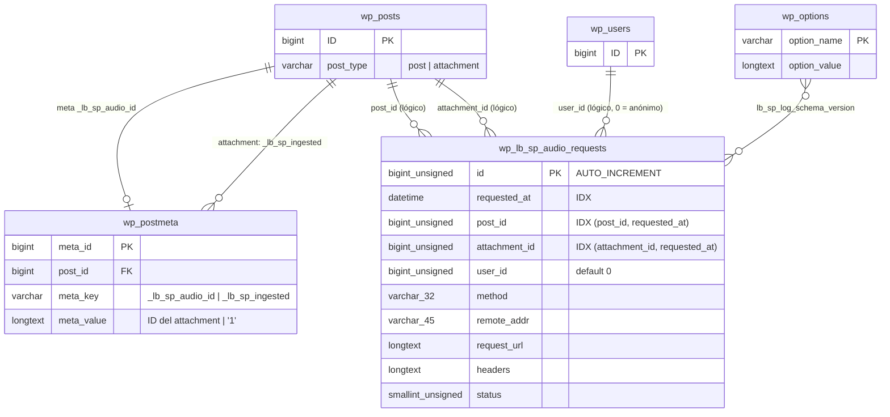

# Estructura de datos en la base SQL

El plugin crea una sola tabla propia y usa tablas nativas de WordPress para el resto.

La línea entre `wp_options` y la tabla de solicitudes representa solo la opción de versión del esquema. No es una relación SQL.

## Tabla propia: `{prefix}lb_sp_audio_requests`

Se crea con `dbDelta` (`inc/Tracking/RequestLog.php`) y se elimina en `uninstall.php`.

| Columna | Tipo | Notas |
| --- | --- | --- |
| `id` | bigint(20) unsigned | PK, AUTO_INCREMENT |
| `requested_at` | datetime | |
| `post_id` | bigint(20) unsigned | default 0 |
| `attachment_id` | bigint(20) unsigned | default 0 |
| `user_id` | bigint(20) unsigned | default 0 (anónimo) |
| `method` | varchar(32) | |
| `remote_addr` | varchar(45) | |
| `request_url` | longtext | |
| `headers` | longtext | |
| `status` | smallint(5) unsigned | |

Índices: `requested_at`, `(post_id, requested_at)` y `(attachment_id, requested_at)`.

No tiene claves foráneas. `post_id`, `attachment_id` y `user_id` apuntan a `wp_posts` y `wp_users` solo de forma lógica.

## `wp_postmeta`

| Clave | Objeto | Valor |
| --- | --- | --- |
| `_lb_sp_audio_id` | post | ID del attachment de audio |
| `_lb_sp_ingested` | attachment | `'1'`. Marca los audios creados por el plugin; solo esos se borran al reemplazar el audio |

## `wp_options`

| Opción | Uso |
| --- | --- |
| `lb_sp_channel` | Configuración del canal del feed |
| `lb_sp_feed_version` | Versión del feed |
| `lb_sp_log_schema_version` | Versión del esquema de la tabla |
| `lb_sp_errors` | Últimos 50 errores y avisos del plugin (fecha, origen, motivo, contexto, estado leído); sin autoload |
| `lb_sp_errors_version` | Versión de la migración de los indicadores antiguos `lb_sp_log_error` y `lb_sp_storage_warning` |
| `lb_sp_stats_version` | Versión de invalidación para la caché de estadísticas del Dashboard (`lb_sp_stats_*`); sin autoload |

## Transients

- `lb_sp_feed_body`: caché del XML del feed.
- `lb_sp_stats_*`: caché de 1 hora de los agregados del Dashboard (`RequestStats::dashboard_data()`).
- Un transient por post con el mensaje de error del metabox, que dura 1 minuto.
