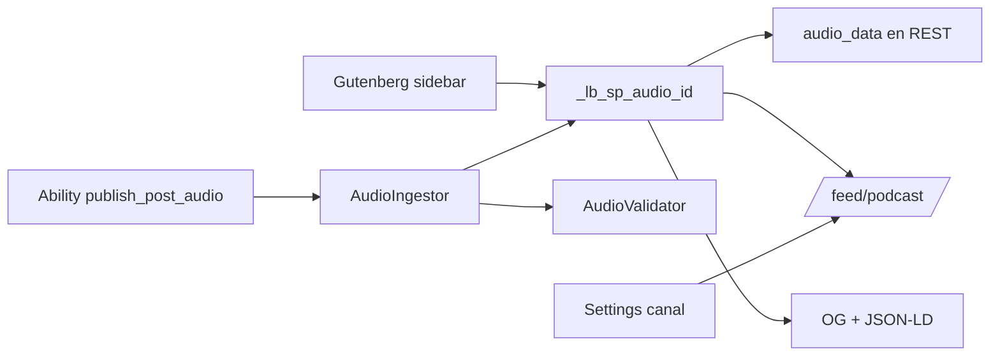

# Plan de implementación: lb-simple-podcast

Directorio: `/home/lbonomo/proyectos/wordpress/plugins/simple-podcast` (montado por Lando en `wp-content/plugins/simple-podcast`).

## Problema

Extender el post type `post` con un MP3 asociado, generar un feed RSS válido para Apple Podcasts, inyectar SEO (Open Graph y JSON-LD) y exponer una ability de WordPress que `mcp-adapter` publica como tool MCP. El plugin es nuevo; el repo solo tenía `docs/requerimiento.md`.

## Decisiones del usuario

- Slug, text domain y archivo principal: `lb-simple-podcast`. Namespace PHP: `LbSimplePodcast`. Prefijo de meta, opciones y funciones: `lb_sp_`.
- Los datos del canal van en una página de Settings propia.
- La ability soporta `audio_url` y `audio_base64`. Tamaño máximo: el que permita PHP (`min( wp_max_upload_size(), estimación por memory_limit )`).
- Entorno Lando según el documento (el `.lando.yml` vive en `../server`). Las credenciales locales de test (Application Password en requerimiento.md) se dejan como están.
- Idioma de la documentación y respuestas: español.

## Correcciones al documento original

- La integración MCP usa la Abilities API: `wp_register_ability()` en el hook `wp_abilities_api_init`, con `meta.mcp.public => true`. No existe `mcp_register_tool()`. Se detecta con `function_exists( 'wp_register_ability' )`. El plugin requiere WP ≥ 6.4, PHP ≥ 8.1, y la ability solo se registra en WP ≥ 6.9.
- Se usa `download_url()` + `media_handle_sideload()`, no `media_sideload_image`.
- La URL del audio se deriva de `_lb_sp_audio_id` y no se guarda. `audio_data` en REST se calcula de ese ID.
- El meta con prefijo `_` es protegido, así que se define `auth_callback` para REST.
- Se cargan `wp-admin/includes/{file,media,image}.php` en contextos no-admin (REST/MCP).
- La query del feed usa `meta_query` con `compare '>'`, `value 0`, `type NUMERIC`.
- El feed se registra con `add_feed( 'podcast', ... )`.
- Para `audio_base64` se estima el tamaño (`strlen * 3/4`) antes de decodificar y se rechaza si supera el límite. La decodificación es estricta.
- Seguridad SSRF para `audio_url`: `wp_http_validate_url` + `reject_unsafe_urls`, solo http/https, con timeout y tope de tamaño. En Lando local se permite un filtro de allowlist para pruebas.
- El build corre `composer install --no-dev`. `vendor/` queda incluido en el zip.
- Se usa `@wordpress/scripts` para los assets, y se quita `webpack.config.js` del `.distignore`.

## Requisitos de feed (spec Apple)

- Cabecera `<?xml version="1.0" encoding="UTF-8"?><rss version="2.0" xmlns:itunes="http://www.itunes.com/dtds/podcast-1.0.dtd" xmlns:content="http://purl.org/rss/1.0/modules/content/">`.
- Respuestas a HEAD y byte-range en los archivos de audio (los sirve el servidor web; se documenta y se prueba con curl).
- `<enclosure url length type>` único por episodio, con GUID inmutable (`isPermaLink="false"`).
- Fechas RFC 2822.
- Entidades XML seguras: sin `&rsquo;` ni similares, con `&amp;` escapado.
- Nombres de categoría con la capitalización exacta de Apple.
- Tags de canal obligatorios: `title`, `description`, `language`, `itunes:image`, `itunes:category`, `itunes:explicit`. Recomendados: `itunes:author`, `itunes:owner`.
- Tags de episodio: `title`, `itunes:duration`, `itunes:explicit`, `itunes:summary`, `pubDate`, `itunes:episodeType`.

## Arquitectura



```text
lb-simple-podcast/
├── lb-simple-podcast.php
├── uninstall.php
├── composer.json, package.json, phpunit.xml.dist, phpstan.neon.dist, phpcs.xml.dist
├── .distignore, .gitignore
├── bin/build-zip.sh
├── .github/workflows/{test.yml,build-release.yml}
├── inc/
│   ├── Plugin.php
│   ├── Meta/AudioMeta.php          # register_post_meta + REST audio_data
│   ├── Media/AudioValidator.php    # mime real, tamaño, duración
│   ├── Media/AudioIngestor.php     # sideload URL/base64
│   ├── Admin/SettingsPage.php      # datos del canal
│   ├── Feed/FeedRegistrar.php
│   ├── Feed/PodcastFeedRenderer.php
│   ├── Integrations/SeoHeaders.php
│   └── Integrations/McpAbility.php
├── templates/feed-podcast.php
├── assets/src/ y assets/build/
├── languages/
├── docs/
└── tests/{phpunit/Unit,phpunit/Integration,phpstan}
```

## Tareas

### Task 1: Scaffolding, tooling y entorno Lando
- Objetivo: esqueleto del plugin con autoload PSR-4, bootstrap `Plugin.php`, entrypoint, `composer.json`, `phpunit.xml.dist`, `phpstan.neon.dist` (nivel 8 con `szepeviktor/phpstan-wordpress`), `phpcs.xml.dist` (WordPress-Core/Extra/Docs), `.gitignore` y `.distignore`.
- Tests: test de humo que verifica que el plugin se carga y que `Plugin` se inicializa.
- Demo: el plugin se activa en Lando sin errores, y phpunit, phpstan y phpcs pasan.

### Task 2: Validador de audio
- Objetivo: `AudioValidator` comprueba el mime real con `wp_check_filetype_and_ext` (solo `audio/mpeg`), tamaño máximo (límite de PHP) y duración con `wp_read_audio_metadata()`. Devuelve `WP_Error` con códigos claros.
- Tests: MP3 válido, mime falso con extensión `.mp3`, archivo vacío y exceso de tamaño.

### Task 3: Meta de audio y exposición REST
- Objetivo: `AudioMeta` registra `_lb_sp_audio_id` con `register_post_meta` (`absint`, `auth_callback`, `show_in_rest`). Valida que el attachment sea `audio/mpeg` al guardar. Añade `audio_data` a `wp/v2/posts`.
- Tests: ID inválido o no MP3 rechazado, usuario sin `edit_post` no puede escribir, `audio_data` es `null` sin audio.

### Task 4: Sidebar de Gutenberg
- Objetivo: panel en el Document Sidebar con `PluginDocumentSettingPanel` y `MediaUpload` filtrado a `audio/mpeg`. Build con `@wordpress/scripts`, encolado solo en el editor de `post`. Fallback Classic con metabox mínimo.
- Tests: Jest para el componente y test PHP del encolado condicional.

### Task 5: Settings del canal
- Objetivo: `SettingsPage` con Settings API: título, descripción, idioma, imagen, categoría (lista cerrada de Apple), autor, owner, explicit global y copyright. Capability `manage_options`.
- Tests: sanitización, categoría inválida rechazada y defaults.

### Task 6: Feed RSS de podcast
- Objetivo: `FeedRegistrar` con `add_feed( 'podcast' )` y flush en activación/desactivación. `PodcastFeedRenderer` y `feed-podcast.php` generan el XML según la spec de Apple. `Content-Type: application/rss+xml; charset=UTF-8`, `Last-Modified`/`ETag` con 304, límite de ítems filtrable.
- Tests: solo posts publicados con audio, 200 y content-type, XML bien formado, 304, escapes y enclosure.

### Task 7: SEO (Open Graph y JSON-LD)
- Objetivo: `SeoHeaders` en `wp_head` para `is_singular('post')` con audio. Compatibilidad con Yoast y RankMath para evitar duplicados.
- Tests: salida con y sin audio, formato `PT5M45S`.

### Task 8: Ingesta de audio
- Objetivo: `AudioIngestor` desde URL (protección SSRF) y desde base64 (tamaño estimado antes de decodificar, modo estricto). Idempotente: reemplaza el audio existente sin dejar huérfanos.
- Tests: URL válida, SSRF, base64 inválido, exceso de tamaño y no-MP3.

### Task 9: Ability MCP
- Objetivo: `McpAbility` registra `lb-simple-podcast/publish-post-audio` con `wp_register_ability`, `input_schema`/`output_schema`, `permission_callback` con `edit_post` y `meta.mcp.public => true`.
- Tests: `post_id` inexistente, sin permisos, ambos o ningún origen de audio y éxito.

### Task 10: Empaquetado y CI
- Objetivo: `bin/build-zip.sh` (`--no-dev`, incluye `vendor/` y `assets/build/`), workflows `test.yml` y `build-release.yml`, `uninstall.php`.
- Tests: el zip no contiene `tests/`, `docs/` ni `node_modules/`.

### Task 11: Documentación y verificación final
- Objetivo: `docs/` (arquitectura, esquema de la ability, setup Lando), `readme.txt`, y corrección de `requerimiento.md` con las decisiones de este plan.
